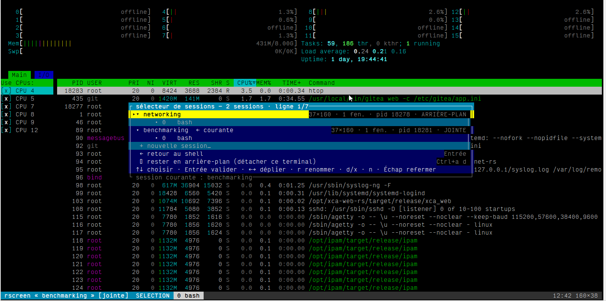

# rscreen

> Also available in French: [README.fr.md](README.fr.md)

**A `gnu-screen` clone written in Rust**: every session survives dropped
connections, every session hosts windows, and a modal picker lists them all —
all inside your terminal, with zero flicker.



*(rscreen in a real terminal: `htop` in the “benchmarking” window, the session
picker open on top of it.)*

`rscreen` is the `screen` you actually want to restart: one small binary, three
dependencies (`libc`, `vt100`, `unicode-width`), zero configuration.

| | |
|---|---|
| 💨 SSH died? Session lives | one detached server per session |
| 🪟 Multiple windows | a shell, a build, `htop`… each in its own pty |
| 🗂️ Session picker | `Ctrl+b` then `a`: modal list, expand/collapse, rename (`r`) |
| ⚡ Zero flicker | **diff-rect** rendering: only what changed hits the screen |
| ⇥ `Tab` belongs to apps | bash completion, vim TAB, editor navigation… untouched |
| 🔁 Hot switching | jumping `dev` → `build` never resets the terminal |
| 🪶 Featherweight | `libc` + `vt100` + `unicode-width`, that's all |

## Install

```sh
cargo build --release            # one binary: target/release/rscreen
make install                     # → /usr/local/bin/rscreen
```

Linux only (ptys, `signalfd`, `TIOCGPTPEER`). Nothing to configure: sessions
live in `$XDG_RUNTIME_DIR/rscreen-<uid>` (or `/tmp/rscreen-<uid>`,
or `$RSCREEN_DIR`). Prebuilt binaries are in the [releases](releases).

## Quick start

```sh
rscreen                          # session “default”, created if missing
rscreen -S dev                   # session “dev”
rscreen                          # from another box: “dev” finds you back
rscreen -ls                      # list sessions
rscreen -S dev -c 'make -j8'     # first window: a specific command
rscreen -S cron -dm -c './nightly.sh'   # start detached, no terminal
rscreen -S dev -x                # kill “dev”
```

### Pointing at a session: name **or** pid

`rscreen -ls` prints both the name **and** the pid, and every command that talks
to a session takes either one, on its own or as a positional argument — like
`screen` does:

```sh
rscreen -r dev             # by name
rscreen -r 12345           # by pid, the one `-ls` shows
rscreen -r 12345.pts-0     # even the “pid.whatever” screen form
rscreen -R 12345           # resume, create if missing (never “default” by accident)
rscreen dev                # an existing name: that's the session, not a command
rscreen -x 12345           # kill it by pid
rscreen -r                 # the single detached session: no name needed
```

A positional argument becomes a session only when one actually matches that name
(or pid); otherwise it stays the command to run. And when `-S` is already there,
`rscreen -S other -r 12345` refuses to guess — `rscreen -ls` says who is who.

Inside a session, windows are driven with the `Ctrl+a` prefix:

| after `Ctrl+a` | effect |
|---|---|
| `n` / `p` / `0`…`9` | next / previous / Nth window |
| `c` | new window |
| `d` | detach (session keeps running) |
| `w` | **session picker** — same as `Ctrl+b` then `a` |
| `k` / `x` | kill window / session |
| `[` | scrollback (`↑ ↓ PgUp PgDn`) |
| `t` | session status · `?` help |

The picker (`Ctrl+b` `a`, or `w`) is real modal navigation: `↑` `↓` to move,
`→` to expand a session's windows, `Enter` to join, `r` to rename, `d` to
background, `x` to kill, `n` for a new one. That's all — `Tab` still belongs
to the app.

## How it holds together

```
real terminal ⟷ rscreen client ⟷ unix socket ⟷ session server ⟷ window ptys
```

The server keeps a **VT100 emulator** (`vt100`) for every window, so it knows
the exact state of each screen. It never replays or summarizes — it sends the
client only the **diff** against the screen state that client was last given.
Hence instant rejoin, flicker-free window switching, and the fact that
disconnecting changes nothing: nothing is “replayed”, everything is already
there.

That work happens once per **view** — a view being *(window, scroll position)*
— rather than once per attached client: everyone watching the same view gets
the same frame and shares one reference snapshot. A client out of step (just
joined, changed window, size or scroll offset, asked for `Ctrl+a l`) receives a
full redraw instead, which puts it back in step. See *Rendering* below for why
that convergence matters and what it costs.

Sessions are self-contained: each server stores `sock`, `pid` and `state` in
its directory, and clients enumerate them by scanning that directory (killing
dead sessions on the way). Renaming a session is a real `rename(2)` on its
directory — the socket follows without changing inode, and already-connected
clients live on.

<details>
<summary>More technical detail (keyboard, kitty protocol, rendering…)</summary>

* **Rendering: a frame per view, not per client.** Cloning a `vt100::Screen`
  copies both grids *and the whole scrollback* — ~10 MB and ~2 000 `Vec`s at
  the default `-H 2000` — to show 48×160 cells (245 KB). That used to be paid
  once per client, 90 times a second. So the reference screen now belongs to
  the view (`Win::shots`): the diff, the snapshot and the encoded frame are
  computed once per view per pass and shared by `Rc`; two clients out of two
  different snapshots would never share anything, which is exactly why the
  lagging client is given a full redraw — both paths land on the same state,
  so the view converges. Snapshots of views nobody watches are released.
  Measured cost of one render pass (48×160, `-H 2000`, a window flooding
  output, `make bench`):

  | clients attached | before | after |
  |---|---|---|
  | 1 | 236 µs | 188 µs |
  | 2 | 498 µs | 188 µs |
  | 3 | 772 µs | 188 µs |

  End to end, the server now recaches as much application output with two
  clients as with one (4.18 → 4.16 MB/s at 100 % CPU): the photocopy is no
  longer the bottleneck.
* **Cursor**: visibility belongs to the **application** (`DECSI 25`), not to
  rscreen — the server enforces it on every full render. rscreen hides it only
  inside its own modal overlays.
* **Keyboard**: only two keys are ever “claimed” — `Ctrl+a` (prefix, like
  gnu-screen) and the `Ctrl+b`-then-`a` pair (picker). Both are plain control
  bytes, so they work on any terminal, including ones that can't send
  `Ctrl+Tab`. Since `Tab` is no longer captured, a lone `Ctrl+b` is returned
  to the app after 300 ms: readline keeps its backward-char.
* **kitty keyboard protocol**: the client probes (`CSI ? u`) and activates
  (`CSI > 1 u`) when the terminal speaks it — enabling `Ctrl+Enter` (detach)
  and translating extended keys back to legacy bytes for inner apps. If a
  window's app requests the protocol itself, translation is disabled for that
  window and the app's query gets a proper answer.
* **Status line**: the last line is reserved by the client; the real
  terminal's scroll region is bounded (`CSI 1;<n> r`) so renders never touch it.
* **Sessions**: switching between sessions is hot — no terminal re-init.
</details>

## Testing

```sh
make test       # unit tests (rendering, keys, state machines…)
make itest      # end-to-end: rscreen driven inside real ptys
                # 55 checks (60 with pyte), 15 on session targeting,
                # 23 on renaming a session from the picker
make bench      # hot path: cost of a render pass, server throughput (1–3 clients)
make dump       # replays the client's screen into a VT emulator (pyte)
```

## Known limitations

* no `split` (side-by-side panes) — windows take the whole screen, like gnu-screen;
* no character-wise selection: the scrollback is readable, not copyable;
* multiple clients on one session share the same active window, like `screen`
  in multi-terminal mode.

## License

MIT — see [LICENSE](LICENSE).
